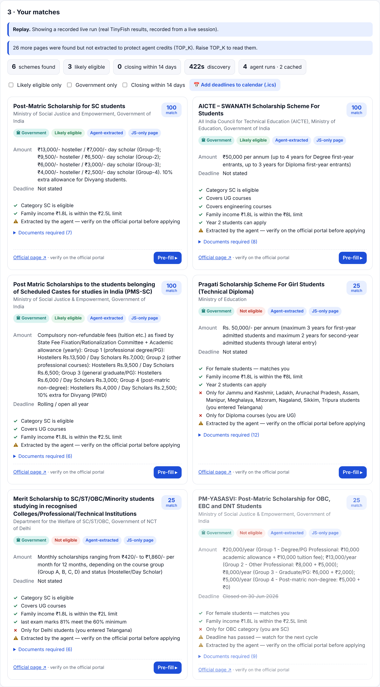
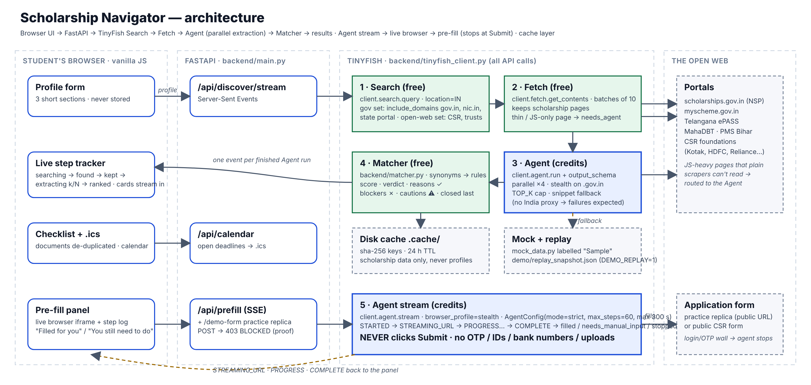

# Scholarship Navigator 🎓

**Team Twin Paradox · HackIIITD 2026 (Tech Council, IIIT Delhi) · presented by TinyFish**

Every year crores of rupees in scholarships go unclaimed because eligible students never find them, miss deadlines, or give up halfway through confusing forms. Information is split across dozens of portals, many of them JavaScript-heavy government sites ordinary scrapers can't read. Scholarship Navigator lets a student describe themselves **once**; TinyFish **Search** and **Agent** then find the government schemes and private scholarships they qualify for (NSP, myScheme, state portals like Telangana ePASS / MahaDBT, CSR foundations), extract **amount, deadline, eligibility and documents**, rank them with plain-English reasons, and finally a TinyFish agent **pre-fills the application form up to, but never past, the Submit step**.





## How TinyFish is used (all calls in `backend/tinyfish_client.py`)

| Step | TinyFish API | Cost | What it does |
|---|---|---|---|
| 1. Discover | **Search** `client.search.query(…, location="IN", include_domains=…)` | free | Up to 6 profile-built queries: a **government set** restricted to `scholarships.gov.in, myscheme.gov.in, gov.in, nic.in` + the student's state portal, and an **open-web set** (CSR foundations, trusts) with social sites excluded |
| 2. Filter | **Fetch** `client.fetch.get_contents(urls, format="markdown")` | free | Renders every candidate in batches of 10; keeps scholarship pages; flags thin/JS-only pages as `needs_agent` (those go first to the Agent) |
| 3. Extract | **Agent** `client.agent.run(goal, url, output_schema=SCHOLARSHIP_SCHEMA)` ×4 in parallel, `stealth` on `.gov.in` | credits | Structured fields (amount, deadline, eligibility, documents…); cached 24 h; capped by `TOP_K`; snippet fallback if a run fails |
| 4. Match | none (`backend/matcher.py`) | free | Synonym normalisation → weighted rules → score, verdict, ✓ reasons, ✗ blockers, ⚠ cautions; closed schemes last |
| 5. Apply | **Agent stream** `client.agent.stream(…, browser_profile="stealth", AgentConfig(mode="strict", max_steps=60, max_duration_seconds=300), output_schema=PREFILL_SCHEMA)` | credits | Fills the form, streams `STARTED → STREAMING_URL → PROGRESS… → COMPLETE` to the browser, returns `{filled, needs_manual_input, stopped_before}`. **Never submits.** |

`output_schema` uses only `type / properties / items / required` (anything else is rejected by the API). `AgentConfig.max_steps` / `max_duration_seconds` are a gated beta feature: if the API refuses them the client retries once with `mode` only (see CHANGELOG). There is no India proxy (US/GB/CA/DE/FR/JP/AU only), so some `.gov.in` portals may block the cloud browser; failures are expected and handled, not fatal. Live evidence: `evidence/smoke_20261016_070313.json`, `evidence/live_bench.json`.

## Safety rules (enforced in code, not just in prose)

1. **Never submit.** Every pre-fill goal ends with the mandatory "never click Submit/Pay/Final Save, never create accounts, never enter passwords/OTP/captcha, never upload, stop and report" block; the run uses `mode="strict"` with `max_steps=60`. The hosted practice form answers **403 BLOCKED** to any POST, so a violation would be visible on screen.
2. **Student data is sensitive** (caste, income, gender, disability — India DPDP Act, 2023). Profiles are read from the request, used in memory, never written to disk or logs. Cache keys are SHA-256 hashes; cached files hold scholarship data only.
3. **Honest UI.** Sample data is badged *Sample*; agent-extracted data shows its source link and "verify on the official portal"; the hosted form is loudly labelled a practice replica.
4. **Credits are protected.** Search and Fetch are free; Agent runs are capped (`TOP_K`, default 6), cached for 24 h, never looped.

## Run it

```bash
git clone https://github.com/<you>/scholarship-navigator && cd scholarship-navigator
python3 -m venv .venv && source .venv/bin/activate
pip install -r backend/requirements.txt
cp .env.example .env            # paste your key (see below) — or leave it empty for sample mode
python backend/test_pipeline.py # 22 offline tests, no network
uvicorn backend.main:app --reload --port 8000
# open http://localhost:8000
```

### Get a TinyFish key and prove it works (Phase 1)

1. Sign in at **https://agent.tinyfish.ai/api-keys**, create a key, put it in `.env` as `TINYFISH_API_KEY=…`.
2. `python backend/smoke_test.py` — runs one Search (`"NSP post matric scholarship 2026-27"`, `location="IN"`) and one Agent extraction on a public scholarship page (default: the AICTE Pragati page; override with `--url …`; `--skip-agent` to spend no credits). It prints the top 5 results, the JSON extraction, status and time, and saves `evidence/smoke_<timestamp>.json` for the deck.

### Modes

| Mode | How | What you see |
|---|---|---|
| **Live** | key in `.env` | Real TinyFish Search → Fetch → Agent; header pill "Live · TinyFish" |
| **Sample** | no key, or `MOCK=1` | Labelled sample schemes, simulated pre-fill (same UI path, including `STREAMING_URL`) |
| **Replay** | `DEMO_REPLAY=1` | Replays `demo/replay_snapshot.json` (a genuine live run recorded on 2026-10-16) with realistic delays — works on bad venue Wi-Fi. Re-record any time with `python scripts/record_replay.py` (needs a key). `DEMO_REPLAY_SPEED=2` plays faster. |

Other knobs (`.env.example`): `TOP_K`, `EXTRACT_WORKERS`, `RETRY_THIN_EXTRACTION=1` (second, narrower Agent goal when an extraction comes back mostly empty), `CACHE=0`, `PUBLIC_BASE_URL`.

### API

| Endpoint | Purpose |
|---|---|
| `GET /api/health` | mode, SDK version, replay availability |
| `POST /api/discover` | plain JSON `{results, checklist, meta}` (used by tests) |
| `POST /api/discover/stream` | SSE: `searching → found N → kept M → extracting k/N (one per finished Agent run, already scored) → ranked` |
| `POST /api/prefill` | SSE agent events; body `{url, profile, scheme_name}` |
| `POST /api/calendar` | `.ics` of open deadlines (3-day alarm) |
| `GET /demo-form` · `POST /demo-form/submit` | practice replica · always 403 BLOCKED |

## Deploy (needed for the pre-fill demo)

TinyFish's browser runs in the cloud and **cannot reach `localhost`**, so `/demo-form` must have a public URL.

- **Render:** push the repo, "New → Blueprint", pick `render.yaml`, set `TINYFISH_API_KEY` and `PUBLIC_BASE_URL` in the dashboard.
- **Railway:** `railway up` (uses `railway.json`/`Procfile`); set the same two variables.
- **Fly.io:** `fly launch` (Procfile is honoured); `fly secrets set TINYFISH_API_KEY=…`.

Health check: `GET /api/health`. Keep `MOCK=0`, `DEMO_REPLAY=0` in production; flip `DEMO_REPLAY=1` for a venue with bad Wi-Fi.

## Demo assets

- `scripts/capture.py` — Playwright screenshots → `deck/assets/01-profile … 06-prefill-result` (+ `-mobile`, plus `07-demo-form`, `08-blocked`). Uses the pre-installed Chromium; don't run `playwright install`.
- `docs/DEMO_SCRIPT.md` — 2-minute recording script. `deck/DECK.md` — slide-by-slide content. `deck/architecture.mmd` → `deck/architecture.png` (`scripts/render_architecture.py`).
- `SUBMISSION_CHECKLIST.md` — what Unstop needs.

## Project layout

```
backend/
  main.py             FastAPI + SSE + practice form + static frontend
  tinyfish_client.py  ALL TinyFish calls (Search → Fetch → Agent extract → Agent pre-fill stream), modes, budgets
  matcher.py          synonym normalisation, deadline/money parsing, explainable scoring, checklist
  mock_data.py        labelled sample schemes + fake pipelines
  cache.py / replay.py / ics.py
  test_pipeline.py    22 offline tests · smoke_test.py (needs key)
frontend/index.html   single page, vanilla JS (EN/हिंदी toggle) · demo_form.html practice replica
scripts/              capture.py · record_replay.py · render_architecture.py · push_to_new_repo.sh
deck/                 DECK.md · architecture.mmd/.png · assets/
docs/DEMO_SCRIPT.md · CHANGELOG.md · SUBMISSION_CHECKLIST.md · render.yaml · Procfile
```

## Out of scope (by design)

User accounts, databases, payments, actually submitting applications, uploading real documents, scraping behind logins, a mobile app, any LLM other than TinyFish for reading the web.

## Team

Team Twin Paradox — `[FILL IN names, roles, college, contact]`
